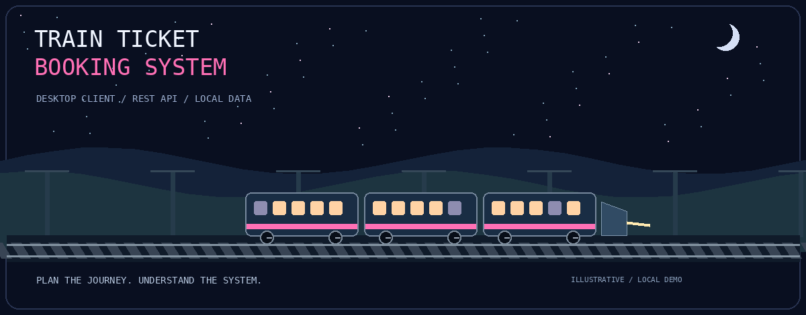
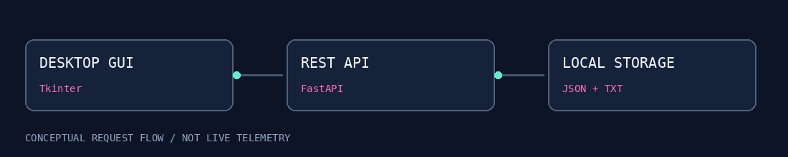

<div align="center">



# Train Ticket Booking System

### Plan the journey. Understand the system.

A Python desktop booking prototype connecting a Tkinter interface to a FastAPI
backend, with local file storage, seat reservations, refund rules, and reporting.

`Python` · `Tkinter` · `FastAPI` · `Requests` · `JSON + TXT`

[Quick start](#quick-start-v2) · [Capabilities](#what-the-project-covers) · [Architecture](#how-the-pieces-connect) · [API](#api-at-a-glance) · [Limitations](#current-limitations)

</div>

---

> Independent educational project. Not affiliated with Bangladesh Railway and not
> connected to its live reservation system. Reservations, schedules, prices, ticket
> artifacts, and refund calculations in this project are demonstration data—not
> valid travel bookings, official railway policies, or processed financial transactions.

## What is this?

Booking a seat looks simple until you build the rules behind it: who owns the
reservation, which seats are unavailable, how multiple seats are allocated, and
what happens when a journey is cancelled.

This repository explores those questions through a local desktop application
and a separate HTTP API. It contains an earlier V1 implementation and an expanded
V2 implementation. This guide uses V2 as its main entry point.

Project status: development prototype. The source was reviewed for this guide,
but end-to-end desktop execution, performance, and deployment security have not
been independently verified. It is not production-ready.

The banner and flow animation are original illustrative artwork, not screenshots,
recordings, live train locations, or performance telemetry.

## What the project covers

| Area | Present in V2 source | Important qualification |
| :--- | :--- | :--- |
| Accounts | Registration, login, bearer-token handling, profile, booking history | Authentication needs hardening before deployment. |
| Email access | Client and GUI paths for verification and one-time login codes | Provider setup and security review required. |
| Train catalogue | List, add, update, delete operations | Client/server request formats need alignment for some management actions. |
| Reservations | Single-seat, batch-seat, and round-trip endpoints | Multi-booking ID generation and seat validation need fixes. |
| Availability | Booked-seat lookup by train, date, and coach | Active-status rules are not consistent across all booking paths. |
| Refunds | Request records, ownership check on requests, status lookup, amount calculation | Simulation only; no funds are transferred. |
| Schedules | Station timetable, platform, and delay fields | Stored locally, not a live railway feed. |
| Reports | Revenue-style summaries, coach occupancy, popular routes | Calculations are based on local booking records. |
| Ticket email | HTML confirmation and booking-ID QR attachment code in the GUI | SMTP credentials and connectivity required; not official ticket validation. |
| Notifications | Reminder endpoint and notification helper functions | Generic email/SMS helper functions include no-op placeholders. |

## Quick start: V2

### 1. Clone and enter the correct folder

```bash
git clone https://github.com/Hameem-Bhai/Train-Ticket-Booking-System.git
cd Train-Ticket-Booking-System
cd "Train Ticket Booking System/TrainBookingSystem_V2"
```

The spaces and nested folders matter. Run the following commands from the V2
folder, not from the repository root or the V1 folder.

### 2. Create a Python environment

Use a supported Python 3 installation with Tkinter available. The repository has
not established a tested minimum version or an OS compatibility matrix.

```bash
python -m venv .venv
```

Windows PowerShell:

```powershell
.venv\Scripts\Activate.ps1
```

macOS / Linux:

```bash
source .venv/bin/activate
```

Install the V2 dependencies:

```bash
python -m pip install -r requirements_v2.txt
```

If activation is blocked on Windows, use `.venv\Scripts\python.exe` in place of
`python` in the install and launch commands.

### 3. Start the API — terminal one

```bash
python -m uvicorn api_server_v2:app --host 127.0.0.1 --port 5001
```

This command explicitly matches the V2 client's default address:

- API: http://127.0.0.1:5001/
- Interactive API documentation: http://127.0.0.1:5001/docs

Keep the terminal open. Do not expose the server publicly without addressing the
security and correctness limitations below. Start with one server process.

### 4. Start the desktop app — terminal two

Open another terminal in the same V2 folder and activate the same environment:

```bash
python main_v2.py
```

The GUI uses Tkinter and needs a graphical desktop session. To check Tkinter:

```bash
python -m tkinter
```

If unavailable, install the appropriate Tk support for your Python distribution.
For Ubuntu / Debian's system Python this commonly means `sudo apt install python3-tk`.

### Windows launcher alternative

`START_V2.bat` is intended to start the API, wait for a response on port 5001, and
launch the GUI. Install dependencies first and run it from an environment where
`python` points to the intended interpreter. The two-terminal procedure above
makes startup errors easier to inspect.

## Suggested first walkthrough

Use fictitious details and a disposable local account.

1. Start the API and open `/docs` to confirm it responds.
2. Launch the GUI and inspect the registration / login flow.
3. Configure email only if testing a provider-dependent path.
4. Inspect the train list, schedules, and seat availability.
5. Try a single-seat booking first, then inspect its history.
6. Try a refund request and inspect the resulting status.
7. Explore the reports using your demonstration records.

Fix and test the batch / round-trip ID issue before relying on those flows.
A basic server-root response confirms connectivity, not end-to-end correctness.

## How the pieces connect



```text
Tkinter desktop application
          |
          v
TrainAPIClientV2 / Requests
          |
          | HTTP + bearer token where required
          v
FastAPI + Pydantic
          |
          v
File-backed records / JSON + pipe-delimited TXT
```

| Component | File | Responsibility |
| :--- | :--- | :--- |
| Desktop | `main_v2.py` | User interface, login flow, email-ticket helper. |
| Client | `api_client_v2.py` | HTTP requests, bearer header, response normalization. |
| Server | `api_server_v2.py` | Endpoints, validation, booking logic, persistence. |
| Dependencies | `requirements_v2.txt` | FastAPI, Uvicorn, Requests, Pillow, QR, reporting dependencies. |
| Data | `data_v2/` | Train, booking, account, schedule, and refund records. |

## API at a glance

The table lists representative V2 routes from the reviewed source. The running
OpenAPI documentation is the best reference for request fields and response shapes.
Authentication requirements vary by route and must be audited before deployment.

| Method | Route | Purpose |
| :--- | :--- | :--- |
| GET | `/api/v2/trains` | List trains. |
| POST | `/api/v2/auth/register` | Register with username and password. |
| POST | `/api/v2/auth/login` | Obtain a bearer token. |
| GET | `/api/v2/auth/profile` | Read authenticated profile. |
| GET | `/api/v2/auth/booking-history` | Read linked bookings. |
| GET | `/api/v2/availability` | Check occupied seats. |
| POST | `/api/v2/bookings/single` | Create a single-seat booking. |
| POST | `/api/v2/bookings/batch` | Create multiple seat records. |
| POST | `/api/v2/bookings/round-trip` | Create outward and return records. |
| POST | `/api/v2/refunds/request` | Request a calculated refund. |
| GET | `/api/v2/refunds/status/{refund_id}` | Read a refund record. |
| GET | `/api/v2/schedules/{train_id}` | Read a stored timetable. |
| PUT | `/api/v2/schedules/{train_id}/delay` | Update stored delay minutes. |
| GET | `/api/v2/reports/revenue` | Summarize booking amounts by date range. |
| GET | `/api/v2/reports/occupancy` | Summarize coach occupancy. |
| GET | `/api/v2/reports/popular-routes` | Rank routes from recorded bookings. |

Protected routes expect `Authorization: Bearer <token>`. Keep tokens out of
screenshots, issue reports, commits, and shared logs.

## Refund demonstration rules

The reviewed helper compares the journey date with the cancellation date:

| Days before the journey | Calculated share of recorded price |
| :--- | :--- |
| 7 or more | 90% |
| 3–6 | 70% |
| 1–2 | 50% |
| Less than 1, including negative values in the current helper | 20% |

These are project rules, not Bangladesh Railway policy. Past journeys and repeated
requests need explicit validation. Recording a refund request does not process a
payment or return money.

The revenue endpoint currently includes both `BOOKED` and `PAID` records; its sum
is not necessarily collected cash revenue.

## Storage and repository layout

```text
Train-Ticket-Booking-System/
├── README.md
├── docs/assets/                  # Included documentation animations
└── Train Ticket Booking System/
    ├── README.md                 # Older overview; some details differ from V2
    ├── TrainBookingSystem-Python.zip
    ├── TrainBookingSystem/        # V1 source
    └── TrainBookingSystem_V2/
        ├── api_server_v2.py
        ├── api_client_v2.py
        ├── main_v2.py
        ├── requirements_v2.txt
        ├── START_V2.bat
        ├── test_imports.py
        ├── test_v2.py
        └── data_v2/
            ├── trains.txt
            ├── bookings.txt
            ├── auth.json
            ├── schedules.json
            └── refunds.json
```

`auth.json` can contain account records and tokens. Booking records can contain
names and phone numbers. Use synthetic demonstration data only. Review existing
tracked files before making the repository public; adding `.gitignore` does not
remove data already present in Git history.

A Python thread lock exists around some operations, but is not a database
transaction or a cross-process lock. Multi-file writes can fail partway through;
a single-process prototype should not be described as a concurrency-safe production
reservation service.

## Optional email setup

The GUI's ticket-email service reads these environment variables:

```dotenv
EMAIL_ADDRESS=your-test-sender@example.com
EMAIL_PASSWORD=your-provider-app-password
```

Use a local `.env` in the V2 working directory or environment variables. Never
commit actual values. The GUI uses Gmail SMTP with STARTTLS; provider policies,
credentials, network access, and the separate verification path need testing.
Its configuration helper writes credentials into `.env` as plaintext, so protect
that file locally and prefer a secret-management approach for deployment.

Core file-backed API operations run locally, but email-dependent registration,
one-time login codes, and ticket delivery may require internet and SMTP setup.
This is not an unconditional offline-ready login experience.

## Current limitations

1. Batch and round-trip handlers repeatedly derive the next booking ID from the
   saved file before persisting the new batch. Multiple new records can receive
   the same ID. Allocate unique IDs within the transaction.
2. Round-trip conflict checks consider `BOOKED`, while other availability paths
   also consider `PAID` and `REFUND_REQUESTED`. Centralize seat-state rules.
3. Train add/update client calls send JSON, but the matching server handlers take
   scalar query parameters. Align the request contract and add integration tests.
4. Password hashing uses plain SHA-256. Replace it with a dedicated, salted,
   adaptive password hasher such as Argon2id before handling real accounts.
5. Token verification checks whether a token exists; the reviewed function does
   not enforce age-based expiry. Add expiry, revocation, and session tests.
6. Train-management routes check login but do not show an admin-role check in the
   reviewed handlers. Some schedule/report routes lack authentication; refund
   status lookup needs an ownership check.
7. Generic email/SMS notification helpers contain `pass`, so a success response
   from a reminder endpoint is not proof of message delivery.
8. File persistence, numeric/date validation, duplicate-seat inputs, refund
   idempotency, and failure rollback need stronger guarantees.

This is a targeted source review, not a comprehensive security audit. Use a local
demo environment and synthetic data until correctness and security are improved.

## Testing and a useful next milestone

The repository contains `test_imports.py` and `test_v2.py`. Their presence does not
establish passing tests or coverage. Review them before running against valuable
records; integration scripts can modify local data.

A strong next milestone would test:

- Registration → login → profile → single-seat reservation → history.
- Two requests competing for the same seat.
- Unique IDs across batch and round-trip requests.
- Rejection of occupied, duplicate, negative, and out-of-range seats.
- Refund ownership, repeated requests, and past journey dates.
- Train-management JSON/query contract.
- Failure recovery between booking and account-file writes.

Run tests against temporary data, not committed user records.

## Troubleshooting

| Symptom | Check |
| :--- | :--- |
| `No module named requests` | Install V2 requirements with the interpreter that launches the app. |
| API not running | Keep terminal one open; verify port 5001 and `/docs`. |
| GUI calls a different server | Check `TrainAPIClientV2.base_url`; do not mix V1 and V2 files. |
| Port 5001 already in use | Stop the previous local process, or change both server port and client URL. |
| Tkinter/display error | Install Tk support and use a graphical session. |
| Train creation returns 422 | Check the JSON/query mismatch described above. |
| Email not received | Check provider setup; generic helper placeholders do not deliver messages. |
| Permission errors writing data | Run from a writable local project directory. |

## Contributing

Prefer small, test-backed changes. Describe the problem, expected behavior,
reproduction steps, and affected version. Exclude personal information, tokens,
passwords, `.env`, generated tickets, and real booking records from submissions.

## Licensing

No top-level license file was visible in the reviewed repository listing. This
README does not assign a license. The author should choose and add a LICENSE
before advertising reuse permissions; do not assume another project's MIT license
also applies here.

---

<div align="center">

Built by [Hameem](https://github.com/Hameem-Bhai).

One journey on screen. A whole system behind it.

</div>
